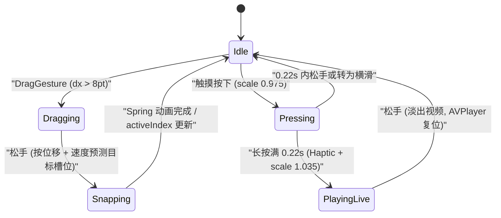

# Spec: 首页三卡组交互动画与长按 Live 预览（Home Hero Deck Interactions）

- **日期**: 2026-11-26
- **状态**: Approved（已确认：最近转换记录同步缓存静音预览视频片段）
- **设计门禁**: L1（现有 `HeroPhotoDeckStage` 视觉结构上的手势物理与微交互增强，沿用 `ObsidianTheme` 现有 Token 与 `AppHaptics`）
- **关联文档**: [docs/architecture.md](../architecture.md)、[docs/design-system.md](../design-system.md)、[docs/decisions.md](../decisions.md)

---

## 1. 目标与背景

目前首页 [HomeView.swift](../../Motion2Live/HomeView.swift) 中的 `HeroPhotoDeckStage` 展示了 3 张扇形叠放的静态卡片（居中主卡 `233×326` + 左右副卡 `164×236`），支持展示最近转换记录（`RecentConversionStore`）或默认演示图（`HeroDemoCenter`、`HeroDemoLeft`、`HeroDemoRight`）。

本次迭代为这 3 张卡片增加两项核心交互体验：
1. **流畅的横滑与点选切换（Gesture-Driven Deck Physics）**：支持左右跟手拖拽切换三张卡片顺序，以及轻点左右副卡直接将其旋转切换至 C 位，具备连续 1:1 插值物理、速度感知弹性吸附（Velocity-aware Spring）与触感反馈。
2. **长按播放 Live（Long-Press Live Preview）**：复刻系统相册 Live Photo 的按压质感——按压蓄力微缩、触发后居中主卡微放大并静音播放对应 Live 视频、顶部 `LIVE` 徽标与底部波形条实时律动，松手后平滑淡出回到静图。

---

## 2. 关键待确认事项（User Review Required）

> [!IMPORTANT]
> **1. 默认演示图的 AI Live 视频资源来源**
> 仓库当前的 `HeroDemoCenter.jpg`（海浪日落）、`HeroDemoLeft.jpg`（手持仙女棒）、`HeroDemoRight.jpg`（花园橘猫）均为**纯静态 JPEG**，不包含内嵌视频流，且当前开发环境无内置 AI 视频生成工具。
> - **方案**：代码层将按资源名（`HeroDemoCenter.mp4`、`HeroDemoLeft.mp4`、`HeroDemoRight.mp4`）从 `Bundle.main` 加载离线静音短视频；若某张演示图尚未放入 `.mp4`，则优雅降级为轻柔的呼吸微动效（Ken Burns 缓慢缩放）+ 波形律动，保证交互始终可用。
> - **配套支持**：下文第 6 节提供了针对这三张图片定制的 **AI 图生视频（Image-to-Video）提示词**，您生成约 2.0–2.4s 竖屏 `.mp4` 后放入 `Motion2Live/Resources/HeroDemo/` 并加入 Xcode Target 即可零改代码生效。

> [!NOTE]
> **2. 「最近转换」卡片支持长按播放 Live（已确认：方案 B）**
> 当用户开启「首页展示最近转换」且有转换记录时，`HeroPhotoDeckStage` 会优先显示最近 1–3 条记录。
> - **已确认决策**：扩展 `RecentConversionStore`，在 `Caches/RecentConversions/` 中同步缓存最多 3 条静音低体积预览视频片段（`<uuid>.mp4`），使最近转换卡片同样支持长按播放真实 Live 视频：
>   - `RecentConversionEntry` 新增可选字段 `videoFileName: String?`（保持旧 `index.json` 向后兼容解码）。
>   - 新增 `videoURL(for entry: RecentConversionEntry) -> URL?`，校验磁盘文件存在后返回。
>   - `recordConversion(imageData:videoURL:durationSeconds:)` 与 `recordConversion(videoURL:durationSeconds:)` 异步生成静音预览 `.mp4`（使用 `AVAssetExportSession` 静音导出或压缩至适配卡片尺寸的轻量片段），持久化至 `Caches/RecentConversions/`；淘汰超出 3 条的旧记录及 `clearHistory()` 时一并删除对应 `.mp4` 文件。
>   - `MediaExportService` 的导出调用点（`exportLivePhoto`、`exportCustomLivePhoto`、`exportVideo`、`exportGIF`）同步传入视频源 URL，测试通过 `RecentConversionStore(directory:)` 隔离验证。

---

## 3. 交互与视觉规格

### 3.1 交互状态机



### 3.2 三卡连续插值几何（`HeroPhotoDeckStage`）

不再使用离散的左/中/右三个硬编码视图，而是将 3 个卡片项放入循环数组（索引 `0, 1, 2`），根据当前 `activeIndex` 与实时 `dragOffset` 计算每张卡的**连续相对槽位** `slot ∈ [-1.5, +1.5]`：
- `slot = 0`：C 位主卡（`x = 0, y = 0, rotation = 0°, scale = 1.0, opacity = 1.0, zIndex = 3`）
- `slot = -1`：左侧副卡（`x = -78, y = 6, rotation = -8°, scale = 0.704, opacity = 0.88, zIndex = 2`）
- `slot = +1`：右侧副卡（`x = +78, y = 10, rotation = +8°, scale = 0.704, opacity = 0.88, zIndex = 1`）

**跟手顺滑度细节**：
- 统一以 `233×326`（圆角 `30pt`）作为基准渲染尺寸，通过 `scaleEffect` 在 `0.704`（对应 `164×236` 视觉比例）与 `1.0` 之间插值，避免拖拽过程中频繁触发布局重算。
- 当 `slot` 经过 `±0.5` 时，加入轻微的弧线外扩（`sin(|slot| * π) * 14pt`）与 `zIndex = 10 - abs(slot)`，让卡片切换呈现自然的「抽卡/翻牌」层次感，避免边缘穿插生硬。
- `LIVE` 角标、时长角标与底部波形条仅随 C 位可见度（`max(0, 1 - abs(slot) * 2.4)`）平滑显隐，避免副卡在切换途中出现文字闪烁。
- 背景两枚环境光晕（Cyan / Indigo）随 `dragOffset * 0.08` 做轻微视差位移。
- 吸附弹簧参数：`.spring(response: 0.36, dampingFraction: 0.80)`；切换成功时触发 `AppHaptics.selection()`。
- 轻点左右副卡直接切换至 C 位，动画与触感与滑动一致。

### 3.3 长按播放 Live 体验

- **零延迟预热**：每次 `activeIndex` 稳定或视图出现时，若当前 C 位卡片存在本地视频 URL，立即异步准备 `AVPlayerItem` 并暂停在 `0.0s`（静音 `isMuted = true`）。
- **按压蓄力与激活**：
  - 按下瞬时轻微内收（`scale = 0.975`），给出物理按压感。
  - 达到 `0.22s` 且未转为横滑时激活 Live：`AppHaptics.mediumImpact()`，卡片弹性微抬至 `scale = 1.035`，阴影略微加深。
  - 视频层（`PlayerView` + `.resizeAspectFill`）在收到首帧就绪后以 `0.16s` 交叉淡入覆盖静图；播放期间循环播放或停留在末帧，直到松手。
  - 播放期间，`LIVE` 图标产生呼吸脉冲，底部 `waveformHeights` 16 根波形柱通过 `TimelineView(.animation(minimumInterval: 1/30))` 呈波浪状平滑律动。
  - 若当前卡片无视频（例如默认 `.mp4` 尚未放入或为纯缩略图），长按仍提供蓄力→微抬→Ken Burns 缓慢推进（`1.0 -> 1.06`）+ 波形律动，保持交互一致性。
- **无障碍适配**：遵循 `@Environment(\.accessibilityReduceMotion)`，减弱缩放弹跳与视差幅度，同时保留切换与预览能力。

---

## 4. 拟变更文件清单

### 4.1 复用与扩展现有组件
- #### [MODIFY] [PlayerView.swift](../../Motion2Live/Views/Components/PlayerView.swift)
  - 为 `PlayerView` 增加可选参数 `videoGravity: AVLayerVideoGravity = .resizeAspect`（默认保持 `.resizeAspect`，不影响 `MotionPhotoView` 等现有调用方），首页卡片传入 `.resizeAspectFill` 实现全出血无黑边填充。

### 4.2 首页卡片组与 Live 播放控制器
- #### [NEW] `Motion2Live/Views/Components/HeroLivePlayerController.swift`（或置于 `HomeView.swift` 同级组件目录并加入 Xcode 工程）
  - `@MainActor final class HeroLivePlayerController: ObservableObject`
  - 负责单个复用 `AVPlayer` 实例的预加载、静音循环播放、首帧就绪状态发布（`@Published var isReadyToDisplay: Bool`）与松手复位清理，避免频繁创建/销毁 `AVPlayer` 造成卡顿。
- #### [MODIFY] [HomeView.swift](../../Motion2Live/HomeView.swift)
  - 重构 `HeroPhotoDeckStage`：
    - 引入 `HeroDeckCardItem` 模型，整合最近转换记录与默认 3 张 `HeroDemo*` 图/视频配置。
    - 实现连续插值三卡轮转布局、速度感知 `DragGesture`、副卡 `onTapGesture` 切换、长按与横滑手势冲突消解。
    - 集成 `HeroLivePlayerController` 与 `TimelineView` 动态波形，实现长按播放 Live 动画与 `AppHaptics` 反馈。
    - 当应用进入后台或视图消失（`.onDisappear`）时自动暂停并复位播放器，释放解码资源。

### 4.3 默认 Live 视频资源（需加入 Xcode Target）
- #### [NEW] `Motion2Live/Resources/HeroDemo/`（`HeroDemoCenter.mp4`、`HeroDemoLeft.mp4`、`HeroDemoRight.mp4`）
  - 通过 `Bundle.main.url(forResource:withExtension:)` 按需读取；无文件时自动回退至微动效。

---

## 5. 验证计划

### 5.1 编译与单元测试（Automated Tests）
每次修改后执行项目标准验证命令：
```bash
xcodebuild build -project Motion2Live.xcodeproj -scheme Motion2Live -destination "generic/platform=iOS Simulator" CODE_SIGNING_ALLOWED=NO

DESTINATION=$(xcrun simctl list devices available iPhone | grep -m1 -oE '[0-9A-F-]{36}')
xcodebuild test -project Motion2Live.xcodeproj -scheme Motion2Live -destination "platform=iOS Simulator,id=${DESTINATION}" -only-testing:Motion2LiveTests CODE_SIGNING_ALLOWED=NO
```
- 为卡片循环索引计算（`cyclicRelativeSlot`、目标索引预测）编写纯 Swift 单元测试，确保左滑/右滑/连续快速滑动边界正确。

### 5.2 手工与 Simulator 冒烟验证（Manual Verification）
- 在 iPhone Simulator（及横屏/分屏尺寸）中验证：
  1. 左右慢速拖拽卡片：3 张卡实时跟手移动、旋转、缩放、层级平滑交替，无闪烁或跳帧。
  2. 快速轻甩（Flick）：能依据滑动速度准确切换至下一张，弹性吸附自然。
  3. 轻点左侧或右侧副卡：平滑旋转切换至 C 位。
  4. 长按 C 位卡片：0.22s 后触感反馈 + 微放大 + 静音视频无缝淡入 + 波形律动；松手平滑复位；长按途中不误触发横滑，横滑途中不误触发长按。
  5. 切换深/浅色模式与「显示最近转换」开关，确认样式与降级表现正常。

---

## 6. 附录：三张默认演示图的 AI 图生视频提示词（建议规格：竖屏 3:4 / 9:16、2.4s、无明显镜头大位移）

1. **`HeroDemoCenter.jpg`（海滩日落海浪 → `HeroDemoCenter.mp4`）**
   - Prompt: `Gentle ocean waves rolling smoothly onto the dark wet sand at twilight, subtle sea foam motion, calm atmospheric sky, locked-off tripod camera, natural realistic motion, 2.4 seconds seamless loop.`
2. **`HeroDemoLeft.jpg`（夜景手持仙女棒 → `HeroDemoLeft.mp4`）**
   - Prompt: `Handheld sparkler sparkling brightly with golden sparks flying outward in slow gentle motion, warm bokeh string lights softly shimmering in the background, subject smiling subtly, locked-off camera, realistic Live Photo style.`
3. **`HeroDemoRight.jpg`（花园阳光橘猫 → `HeroDemoRight.mp4`）**
   - Prompt: `Orange tabby cat in a sunlit garden gently blinking and turning its head slightly, whiskers and fur catching warm golden sunlight, nearby leaves swaying softly in a light breeze, locked-off camera, natural Live Photo feel.`
