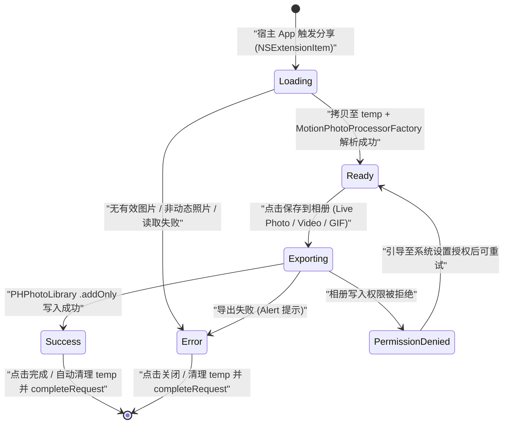

# Spec: iOS 分享菜单直达（Share Extension）

- **日期**: 2026-11-26
- **状态**: Implemented（已确认：扩展内原地预览与导出 + 单张动态图预览导出 + 独立沙盒零 App Group）
- **设计门禁**: L1/L2（复用 `ObsidianTheme`、`PlayerView`、`StudioPrimaryButtonStyle` 与 Liquid Glass 分层规范的紧凑型 Share Sheet 界面，四态齐全）
- **关联文档**: [docs/architecture.md](../architecture.md)、[docs/design-system.md](../design-system.md)、[docs/decisions.md](../decisions.md)

---

## 1. 目标与背景

用户在微信、系统「文件」App、Google Photos 或系统相册中收到或浏览动态照片（Motion Photo）时，当前必须先保存到本地或切回桌面打开 Motion2Live，再通过 `PHPickerViewController` 重新翻找，操作链路长且易在第三方 App 转发过程中丢失对原始字节的定位。

本方案新增 `Motion2LiveShareExtension` App Extension Target，支持在任意宿主 App 的系统分享面板（`UIActivityViewController`）中点击 **「Motion2Live」**，直接在扩展内完成：
1. 接收并拷贝系统分享传入的图像文件（JPEG / HEIC / AVIF）至扩展独立临时目录；
2. 复用主工程 `XMPParser` 与 `MotionPhotoProcessorFactory` 只读解析并校验 `ftyp` 签名；
3. 在扩展内提供静态封面 / 动态视频预览、识别品牌徽标、输出格式切换（**Live Photo / 视频 / GIF**）；
4. 一键调用 `MediaExportService` 请求 `.addOnly` 相册权限并直接写入系统相册，完成后提供清晰成功反馈并安全清理临时文件，无需跳出当前宿主 App。

---

## 2. 已确认决策与边界

- **交互形态**：扩展内原地预览与导出（不依赖非官方 `UIApplication` 响应链跳转主 App）。
- **支持范围（首期）**：单张动态图预览 + 导出（Live Photo / 视频 / GIF）。若用户一次分享多张图片，默认读取首张有效文件并提示或按单张处理；若分享非动态图或不支持的格式，展示清晰的错误空态与关闭按钮。
- **沙盒隔离**：采用独立沙盒模式，不配置 App Group（零额外 Developer Portal Capability）；`MediaExportService` 导出接口新增 `recordRecent: Bool = true` 参数，Share Extension 调用时传入 `false`，避免在扩展 120MB 内存红线内额外生成最近记录视频切片。
- **安全与隐私红线**：
  - 全程纯离线处理，严禁回写宿主传入的原始 URL；
  - 仅在扩展 `FileManager.default.temporaryDirectory` 内读写中间文件，并在 `onDisappear` / `defer` / `extensionContext?.completeRequest` 前通过 `MediaExportService.removeIfInTemporaryDirectory` 清理；
  - `Motion2LiveShareExtension/Info.plist` 声明 `NSPhotoLibraryAddUsageDescription`（及 7 语种 `InfoPlist.strings`），并与 `PrivacyInfo.xcprivacy` 保持一致。

---

## 3. 核心数据流与状态机



---

## 4. 模块与文件变更清单

### 4.1 共享基础层微调（解除对 `UIApplication.shared` 的耦合）
1. **[NEW] `Motion2Live/Models/ExportFormat.swift`**（或迁出 `BatchExportFormat`）：
   - 将当前位于 `BatchConvertView.swift` 的 `enum BatchExportFormat` 抽离为独立文件，供主 App（`MotionPhotoView`、`BatchConvertView`）与 `Motion2LiveShareExtension` 共同编译，避免扩展编译 `BatchConvertView.swift`（内含 `UIApplication.shared`）。
2. **[MODIFY] `Motion2Live/Services/MediaExportService.swift`**：
   - `exportLivePhoto`、`exportVideo`、`exportGIF` 新增默认参数 `recordRecent: Bool = true`，仅当 `recordRecent == true` 时调用 `RecentConversionStore.shared.recordConversion(...)`。

### 4.2 Share Extension Target (`Motion2LiveShareExtension/`)
1. **[NEW] `Motion2LiveShareExtension/ShareViewController.swift`**：
   - `UIViewController` 子类（`NSExtensionPrincipalClass`），承载 `UIHostingController(rootView: ShareExtensionView(...))`，负责从 `extensionContext?.inputItems` 提取图片附件并处理 `completeRequest(returningItems:)` / `cancelRequest(withError:)`。
2. **[NEW] `Motion2LiveShareExtension/ShareAttachmentLoader.swift`**：
   - 异步解析 `NSExtensionItem.attachments`（`[NSItemProvider]`），按优先级匹配 `UTType.jpeg`、`UTType.heic`、`"public.avif"`、`UTType.image`、`UTType.fileURL`；
   - 使用 `loadFileRepresentation(forTypeIdentifier:)` 流式拷贝至扩展独立 `temporaryDirectory`，避免全图字节常驻内存，并校验是否受支持。
3. **[NEW] `Motion2LiveShareExtension/ShareExtensionView.swift`**：
   - 遵循 `ObsidianTheme`（`AppTheme.canvas`、`surface0`、`accent`、`AppHaptics`）与 Liquid Glass 规范构建紧凑预览面板：
     - **Loading 态**：居中 `ProgressView().tint(AppTheme.accent)` + 本地化提示；
     - **Ready 态**：顶部品牌标识 + 关闭按钮；中部圆角预览舞台（复用 `PlayerView` 支持点击播放/暂停动态视频，左下角显示识别出的品牌徽标与时长）；底部 3 段式格式选择器（Live Photo / 视频 / GIF）与 `StudioPrimaryButtonStyle` 保存按钮；
     - **Exporting 态**：按钮禁用 + 局部进度指示；
     - **Success 态**：绿色成功反馈（`AppTheme.success`）+ 「完成」按钮关闭扩展；
     - **Error / PermissionDenied 态**：`AppTheme.danger` 提示图标、本地化错误原因与「关闭」按钮。
4. **[NEW] `Motion2LiveShareExtension/Info.plist` & `PrivacyInfo.xcprivacy`**：
   - `NSExtensionPointIdentifier = com.apple.share-services`；
   - `NSExtensionActivationRule`：使用精确的 `SUBQUERY` 谓词声明支持 `public.jpeg`、`public.heic`、`public.avif`、`public.image` 及图片类 `public.file-url`（单次上限 1–5 项，首期取首张有效动态图）；
   - 配置 `NSPhotoLibraryAddUsageDescription` 与多语言 `InfoPlist.strings`。

### 4.3 本地化与工程配置
1. **[MODIFY] `Motion2Live/Localizable.swift`**：
   - 新增 Share Extension 所需文案键（如 `shareLoadingPhoto`、`shareSaveToPhotos`、`shareSavedSuccess`、`shareNoSupportedImage`、`shareExtensionSubtitle` 等），补齐全部 **7 种语言**（`en` / `zh-Hans` / `ja` / `ko` / `fr` / `de` / `es`）。
2. **[MODIFY] `Motion2Live.xcodeproj/project.pbxproj`**：
   - 新增 `Motion2LiveShareExtension` App Extension Target（`com.apple.product-type.app-extension`，Bundle ID：`com.igloo.MotionPhotoConverter.ShareExtension`，`IPHONEOS_DEPLOYMENT_TARGET = 16.0`）；
   - 将共享核心文件（`XMPParser.swift`、`MotionPhotoProcessor.swift`、`MediaExportService.swift`、`RecentConversionStore.swift`、`ExportFormat.swift`、`ObsidianTheme.swift`、`PlayerView.swift`、`Localizable.swift`）加入 `Motion2LiveShareExtension` 的 Compile Sources；
   - 主 App Target 添加 `Embed App Extensions` Copy Files Build Phase 嵌入 `.appex`。

---

## 5. 验证计划

### 自动化编译与单元测试
1. **主 App + Share Extension 联合编译检查（零警告）**：
   ```bash
   xcodebuild build -project Motion2Live.xcodeproj -scheme Motion2Live -destination "generic/platform=iOS Simulator" CODE_SIGNING_ALLOWED=NO
   ```
2. **核心单元回归测试**（验证 `ExportFormat` 抽离与 `MediaExportService` `recordRecent` 参数兼容原有全部用例）：
   ```bash
   DESTINATION=$(xcrun simctl list devices available iPhone | grep -m1 -oE '[0-9A-F-]{36}')
   xcodebuild test -project Motion2Live.xcodeproj -scheme Motion2Live -destination "platform=iOS Simulator,id=${DESTINATION}" -only-testing:Motion2LiveTests CODE_SIGNING_ALLOWED=NO
   ```
3. **新增针对 `ShareAttachmentLoader` / 解析链路的单元测试**（可放入 `Motion2LiveTests` 验证基于 `NSItemProvider(contentsOf:)` 的拷贝、非动态图拦截与临时文件清理）。

### 模拟器 / 真机手工冒烟验证
1. 在「文件」App 或系统相册中选中一张 Motion Photo（如小米/Pixel/三星样图），点击系统分享按钮 → 列表中出现 **Motion2Live**；
2. 点击后弹出 Share Extension 预览界面，确认品牌识别正确、视频可正常播放、深浅色模式符合 `ObsidianTheme`；
3. 分别测试导出 **Live Photo**、**视频**、**GIF** 至系统相册并核验相册成品；
4. 分享一张纯静态 JPEG，确认弹出「未检测到动态照片数据」友好提示且无崩溃或临时文件残留。

---

### 下一步操作
Plan 已落盘至 `docs/specs/2026-11-26-share-extension.md`，请确认是否批准本方案：
- **「建 Worktree」**：执行 `make wt name=share-extension` 并提供新 Builder 会话启动词；
- **「自动开干」**：由当前调度器自动创建 Worktree、派发 Builder 实施并通过只读 Reviewer 盲审。
